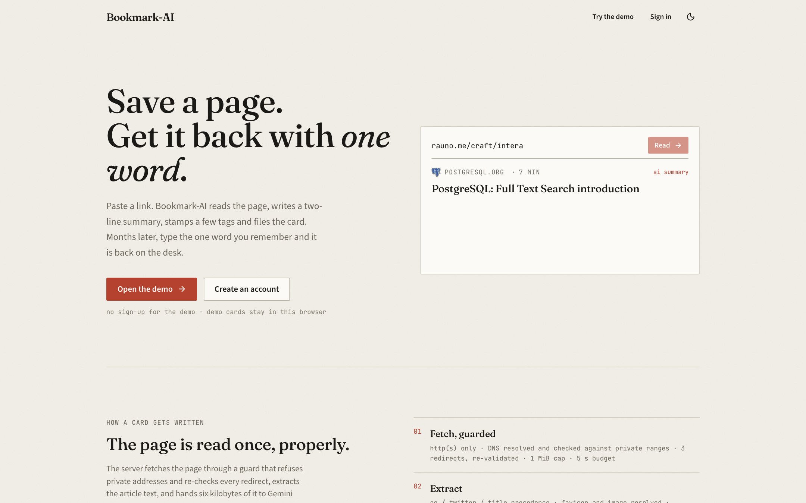
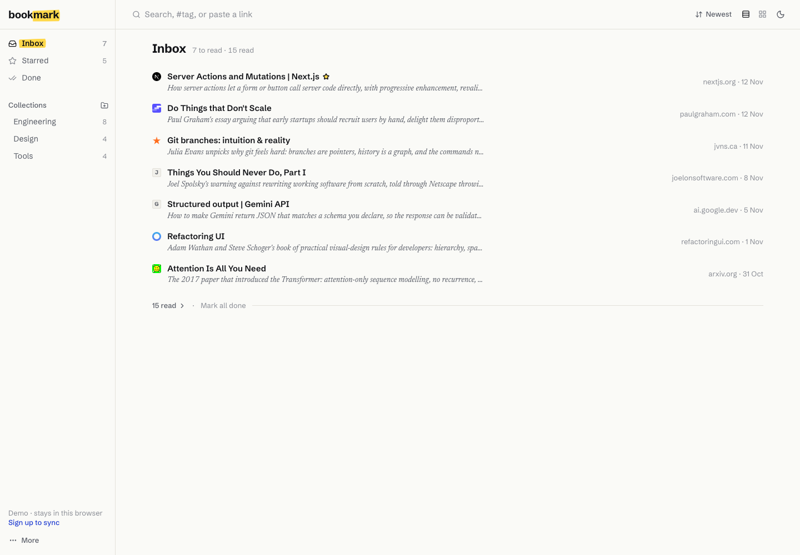
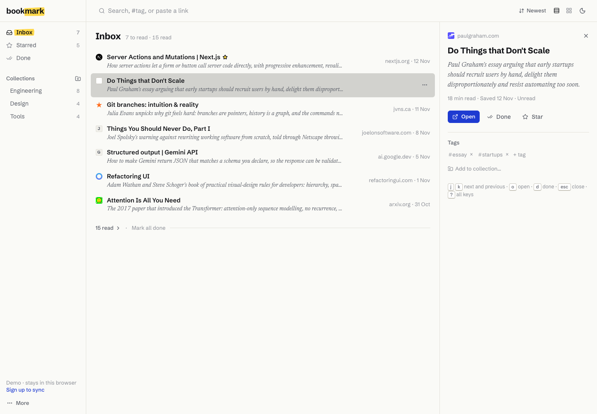

# Bookmark-AI

Save a link now. Find it later with the one word you remember.

**Live:** https://bookmark-ai-beta.vercel.app · **Try it without an account:** https://bookmark-ai-beta.vercel.app/demo

[](https://github.com/meCeltic/Bookmark-AI/actions/workflows/ci.yml)



## What it does

Paste a link. The server reads the page, writes a two-line summary with a few tags, and files it in your Inbox. From then on, any word you remember brings it back: title, summary, tags and URL are all searched, with typo tolerance.

- **An inbox, not a pile.** Unread links sit on top. Press `d` when you're done with one and it drops out of the way. Read links fold into a single line so the Inbox can actually reach zero.
- **Search that forgives.** `recat` finds React. `#design` filters by tag, with autocomplete. Matches are highlighted in place.
- **Keyboard first.** `j`/`k` to move, `o` to open, `space` for a preview pane, `f` to star, `?` for the full list. Every destructive action has an undo.
- **Your data stays yours.** Import the `bookmarks.html` any browser exports (folders become collections, duplicates are skipped). Export back to HTML or JSON at any time.
- **Save from anywhere.** A bookmarklet posts the current tab to `/save`.
- **Dead links are flagged**, so a stale drawer tells you which pages have gone.

| Inbox | Preview | Phone |
| --- | --- | --- |
|  |  |  |

## How it's built

Next.js 16 (App Router, server actions) · React 19 · TypeScript · Tailwind 4 · Supabase Auth and Postgres · Gemini for summaries.

A few decisions I'd defend in a review:

- **The database enforces the rules.** Row-level security on every table. A unique index on the canonical URL per user means a duplicate is refused by Postgres, not by a check that someone could forget. A generated, weighted `tsvector` plus a trigram index back the search function.
- **One repository interface, three implementations.** The UI talks to a `BookmarkRepository`. Demo mode gets a localStorage one, signed-in users get Postgres behind server actions. A single contract test suite runs against both, so the demo is the real app, not a mock.
- **User-supplied URLs are treated as hostile.** Fetches go through a guard that resolves DNS and refuses private, loopback, link-local and metadata ranges (IPv4 and IPv6), re-validates every redirect, caps the body at 1 MiB and the whole exchange at five seconds. The link checker uses the same guard.
- **The model is an upstream, not an oracle.** Gemini is called with a response schema, the reply is validated again with Zod, and anything off-schema or rate-limited falls back to the page's own description, labelled as such. Models are tried in a chain with retries.
- **Validated at every boundary.** Server action input, route bodies, model output, import files and localStorage all pass through the same Zod schemas. Actions return a typed `Result` instead of throwing across the client line.
- **Motion without a library.** Saves, deletes, the preview pane and layout changes use the View Transitions API with a reduced-motion tier. Nothing moves that you're reading.

## Running it locally

```bash
git clone https://github.com/meCeltic/Bookmark-AI
cd Bookmark-AI
npm install
npm run dev
```

That gives you demo mode with no configuration. For accounts and AI summaries, copy `.env.example` to `.env.local`:

| Variable | Needed for |
| --- | --- |
| `NEXT_PUBLIC_SUPABASE_URL`, `NEXT_PUBLIC_SUPABASE_ANON_KEY` | Sign-in and cloud sync. Run `supabase/migrations/0001_init.sql` in the SQL editor first. |
| `GEMINI_API_KEY` | Summaries and tags. The free tier at aistudio.google.com is enough. |
| `NEXT_PUBLIC_SITE_URL` | Absolute links in auth emails and the bookmarklet. |

## Quality

```bash
npm test          # 324 unit and component tests, about two seconds
npm run verify    # lint, typecheck, tests, production build (what CI runs)
scripts/db-smoke.sh   # applies the migration to a throwaway Postgres and checks RLS, the unique index and search as a non-superuser
```

CI runs the full verify step and the database smoke test against a Postgres 16 service on every push.

## Layout

```
app/           routes, API handlers, /save bookmarklet target
components/    dashboard, landing, auth, settings
lib/domain     Zod schemas and the Result type
lib/repo       BookmarkRepository: local, supabase, remote, plus contract tests
lib/url        canonicalisation and the SSRF guard
lib/enrich     page extraction, Gemini call, fallback pipeline
lib/search     ranking with typo tolerance
lib/import     browser bookmarks.html parser
supabase/      schema migration and SQL smoke test
```

## License

MIT · built by [Ankit Singh](https://github.com/meCeltic)
