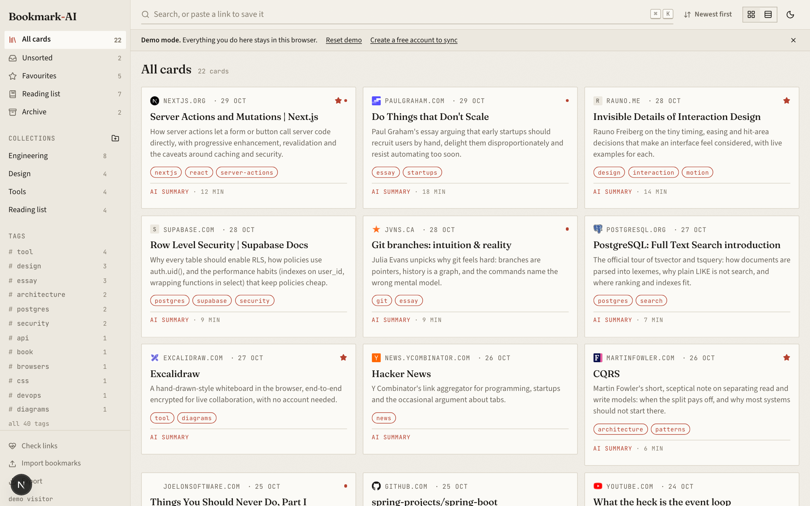
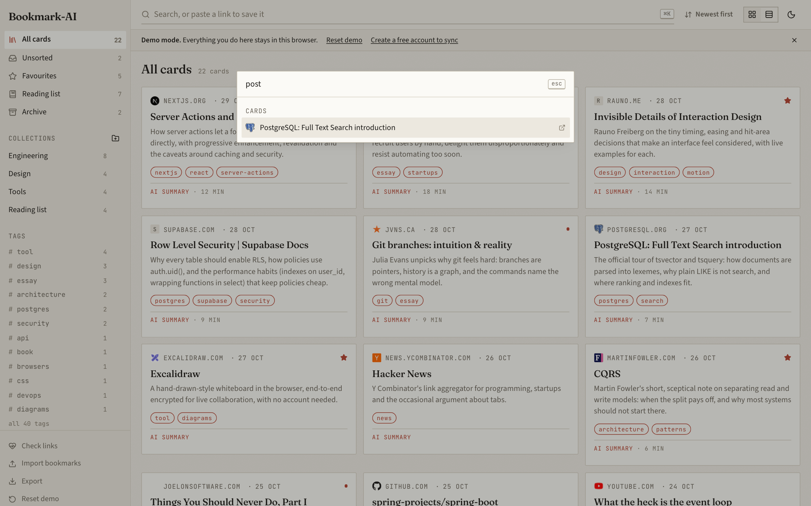
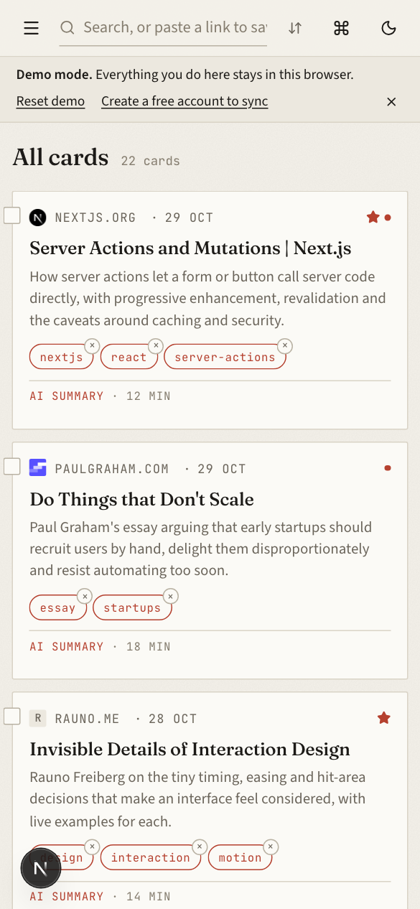

# Bookmark-AI

Save a page. Get it back with one word.

Paste a link and Bookmark-AI reads the page, writes a two-line summary, stamps a few tags and files the card. Months later you type the one word you remember and it is back on the desk.

**Live demo:** https://bookmark-ai-beta.vercel.app/demo (no account needed; demo cards stay in your browser, only the URL you paste goes to the server to be read)

[](https://github.com/meCeltic/Bookmark-AI/actions/workflows/ci.yml)



## Why I rebuilt it

The first version of this repo was a weekend take-home from 2025. It had a Supabase schema the UI never called, a "summary" that was a raw page dump, and a bookmarks list that lived in `localStorage` behind a login that protected nothing. I kept the name and the idea and rewrote everything else, this time the way I would build a service at work: a schema with row-level security, a repository boundary so the UI does not care where data lives, an enrichment pipeline that treats a language model as an untrusted upstream, and a demo mode so the link on my résumé works for anyone in three seconds.

## What it does

- **Reads the page for you.** Title, favicon, image, reading time, and a summary with 3–5 tags and a category written by Gemini. No key or quota? The page's own description is used and the card says `meta` instead of `ai`.
- **Keeps a tidy drawer.** Collections, plus five built-in views: all, unsorted, favourites, reading list (unread), archive. Tags are filters with counts.
- **Finds things again.** One input that filters as you type and flips into Save mode when it sees a link. `⌘K` palette. Search is substring-first with word-level typo tolerance, so `recat` finds React without matching every summary that contains those letters.
- **Works from the keyboard.** `j`/`k` walk cards, `f` favourite, `e` archive, `⌫` delete, `x` select, `?` shows the sheet. Delete and bulk actions are undoable from the toast.
- **Moves your data in and out.** Import the `bookmarks.html` any browser exports; folders become collections and duplicates are skipped. Export back to browser HTML or JSON.
- **Tells you what is dead.** Link health check with bounded concurrency, badges on the cards, a filter for the dead ones.
- **Refuses duplicates.** URLs are canonicalised (no `utm_*`, `www.`, fragment or trailing slash) and a unique index in Postgres is the last word.
- **Demo mode.** `/demo` runs the whole app against a localStorage repository with a seeded drawer. Sign up later and bring the demo cards with you.

| Dark | Palette | Mobile |
| --- | --- | --- |
|  |  |  |

## How it works

### How a card gets written

When you paste a link, the server reads the page once and writes the card from what it finds. The fetch goes through a guard that only allows http(s), resolves the hostname and refuses private, loopback and link-local addresses, follows at most three redirects and re-checks each one, stops reading after 1 MiB and gives the whole exchange five seconds. From the HTML it takes the title (Open Graph first, then Twitter, then `<title>`), the favicon and preview image, the article or main text with entities decoded, and an estimated reading time.

About six kilobytes of that text goes to Gemini with a fixed JSON schema in the request. The reply is parsed again by a Zod schema that caps lengths, keeps three to five tags in a safe character set and restricts the category to a fixed list. If there is no API key, the quota is spent or the reply does not fit the schema, the card falls back to the page's own description and records that it did, so the UI never presents a fallback as an AI summary.

Before the card is filed, the URL is canonicalised: `utm_*` parameters, `www.`, the fragment and a trailing slash are removed. A unique index on the canonical URL per user means a duplicate is refused by Postgres rather than by a check in JavaScript, and a generated full-text search vector over title, summary, tags and URL is kept up to date by the database.

### How the app is put together


```
Next.js 16 (App Router)            Supabase
┌──────────────────────────┐       ┌────────────────────────────┐
│ /demo  ──► LocalRepository (browser, localStorage)             │
│ /dashboard ─► RemoteRepository ─► server actions ─► SupabaseRepository ─► Postgres (RLS)
│                                                                │
│ POST /api/enrich ─► ssrf-guard ─► extract ─► Gemini ─► Zod ─► Enrichment
│ POST /api/health ─► ssrf-guard (HEAD, 6 at a time)             │
└──────────────────────────┘       └────────────────────────────┘
```

**One repository interface, three implementations.** The dashboard only knows `BookmarkRepository` (`lib/repo/types.ts`). Demo mode gets `LocalRepository`; signed-in users get `RemoteRepository`, which forwards to server actions that run `SupabaseRepository` with the caller's session. One contract test suite (`lib/repo/contract.test.ts`) pins the behaviour: dedupe by canonical URL, patch semantics, collection deletion unsorting its cards, tag merge.

**Postgres does the hard parts** (`supabase/migrations/0001_init.sql`). Row-level security on every table with `using` and `with check`. A unique index on `(user_id, url_normalized)` so duplicates are a database guarantee, not a JavaScript hope. A generated `tsvector` column with weighted fields (title A, summary B, tags C, url D), a GIN index on it, and a trigram index on title; `search_bookmarks(q)` ranks with `ts_rank_cd` and falls back to `similarity` for typos. `rename_tag` merges a tag across every row in one statement. Tags are a `text[]` on the row rather than a join table: every read needs them, writes are per-row, and a GIN index answers "has tag", so a join table would buy nothing here.

**Fetching user-supplied URLs is a security feature** (`lib/url/ssrf-guard.ts`). http(s) only, hostnames like `localhost`, `*.internal` and `*.local` refused, DNS resolved and every address checked against loopback, RFC 1918, link-local (cloud metadata), CGNAT, multicast and the IPv6 equivalents including mapped IPv4. Redirects are followed manually, at most three, re-validating each hop. Bodies are streamed and cut at 1 MiB; the whole exchange shares a 5 s budget. The same guard fronts the health check.

**The model is an upstream, not an oracle** (`lib/enrich/`). Gemini is called with `responseMimeType: application/json` and a `responseSchema`; the reply is then parsed by a Zod schema that caps lengths, restricts tags to `[a-z0-9 .+#-]` and the category to a fixed enum. Anything off-schema, any quota error and any missing key all land on the same metadata fallback, and the card's status (`done` / `fallback` / `failed`) tells the UI what happened. Route handlers return typed errors with proper status codes and `Retry-After`; a token-bucket limiter is keyed by user id, or by IP for demo visitors.

**Validated at every boundary.** Server action arguments, route bodies, model output, import files and `localStorage` reads all go through the schemas in `lib/domain/bookmark.ts`. Actions return a `Result<T>` instead of throwing across the client line.

### Decisions and trade-offs

| Decision | Why | What it costs |
| --- | --- | --- |
| Full-text search in Postgres, not a vector database | A personal drawer is a few hundred rows; `tsvector` + trigram answers "I remember one word" instantly with no second service. | No semantic search ("that article about cache invalidation" when the word cache is not on the card). |
| Client-side search over the loaded list in the UI | The list is fully loaded anyway; filtering as you type must be instant. The Postgres RPC exists for a future paginated drawer. | Search logic lives in two places until the list is paginated. |
| Tags as `text[]`, not a join table | Simpler reads and writes, GIN index covers filtering, `rename_tag` is one UPDATE. | Tag metadata (colour, description) has nowhere to live. |
| In-memory rate limiter | Zero infrastructure for a portfolio deployment. | Per-instance; the upgrade path is Upstash with the same interface. |
| Demo on localStorage, not an anonymous Supabase user | No sign-up wall, works with every env var missing, no abandoned rows to clean. | Demo data does not sync; "bring them in" on sign-up covers the happy path. |
| Gemini structured output rather than prompt-and-pray | A schema in the request and a schema on the reply give two layers of guarantee. | Tied to one provider; swapping means re-implementing `summarize` behind the same type. |

## Running it

```bash
git clone https://github.com/meCeltic/Bookmark-AI
cd Bookmark-AI
npm install
cp .env.example .env.local   # all optional, see below
npm run dev
```

Open http://localhost:3000. With no env vars at all you get demo mode only, which is a complete app.

| Variable | Needed for |
| --- | --- |
| `NEXT_PUBLIC_SUPABASE_URL`, `NEXT_PUBLIC_SUPABASE_ANON_KEY` | Accounts and cloud sync. Run `supabase/migrations/0001_init.sql` in the SQL editor first. |
| `GEMINI_API_KEY` (`GEMINI_MODEL` optional) | AI summaries and tags. The free tier at aistudio.google.com is enough. Models are tried in a chain (lite first, then larger) and a 404, 429, 503 or timeout moves to the next; without a key, cards use the page description. |
| `NEXT_PUBLIC_SITE_URL` | Absolute links in auth emails. |

```bash
npm test          # vitest, ~270 tests, about a second
npm run verify    # lint + typecheck + test + build, what CI runs

# Apply the migration to a disposable Postgres and check RLS, the unique index,
# search and the trigger as a non-superuser. CI runs this against a service container.
docker run -d --name pg -e POSTGRES_PASSWORD=pg -p 5432:5432 postgres:16-alpine
DATABASE_URL=postgres://postgres:pg@localhost:5432/postgres scripts/db-smoke.sh
```

## Layout

```
app/            routes: landing, /demo, /dashboard, /settings, /login, /signup, /api/enrich, /api/health
components/     dashboard (provider, shell, index card, palette, dialogs), landing, auth
lib/domain      Zod schemas and the Result type
lib/repo        BookmarkRepository + local / supabase / remote implementations + contract tests
lib/url         normalisation, canonical keys, SSRF guard
lib/enrich      HTML extraction, Gemini call, pipeline
lib/search      filters, sorting, ranking
lib/import      Netscape bookmarks.html parser
lib/export      JSON and HTML writers
supabase/       schema migration and the SQL smoke test
scripts/        db-smoke.sh
```

## Roadmap

- Paginate the drawer past a few thousand cards and switch search to the Postgres RPC.
- Reader view from the extracted text, so a card can be read without leaving.
- Magic-link sign-in.
- Upstash-backed rate limiting when there is more than one instance.

## License

MIT
